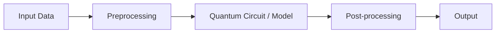

<div align="center">

# Q-matrix

**VTU-QFF-HC-0024** &nbsp;|&nbsp; Tier: **Both**

</div>

---

<div align="center">

| | |
| :--- | :--- |
| **Team** | Q-matrix |
| **Team ID** | VTU-QFF-HC-0024 |
| **Tier** | Both |
| **Repository** | [vtu-hc-q-matrix](https://github.com/vtu-qiskit-fall-fest-2026/vtu-hc-q-matrix.git) |
| **Organisation** | [vtu-qiskit-fall-fest-2026](https://github.com/vtu-qiskit-fall-fest-2026) |
| **Event** | VTU-QFF Hackathon — VTU-Qiskit Fall Fest 2026 |

</div>

---

## 📌 Table of Contents

- [Team Members](#-team-members-github-ids)
- [Problem Statement](#-problem-statement)
- [Proposed Solution](#-proposed-solution)
- [Approach & Architecture](#-approach--architecture)
- [Tech Stack](#-tech-stack)
- [Project Structure](#-project-structure)
- [How to Run](#-how-to-run)
- [How to Push Code](#-how-to-push-code)
- [Submission Checklist](#-submission-checklist)
- [Resources](#-resources)
- [License](#-license)

---

## 👥 Team Members (GitHub IDs)

> Members are added to this repository as **collaborators** and must accept the
> GitHub invitation before they can push. Add your GitHub username below.

| # | Name | GitHub Username | Role |
| :-- | :--- | :--- | :--- |
| 1 | Chinmay R | ChinmayRERC | _Team Lead_ |
| 2 | M Naveen | Naveenmuchetty-67 | _Developer 1_ |
| 3 | Thulasi Ram M  | Ram0528 | _Developer 2_ |

<!--
Optional: add a plain list instead of the table above.
- @username1
- @username2
-->

---

## ❓ Problem Statement

AI-Based Interactive Quantum Algorithm Learning Platform

**Problem Description:** Background Quantum computing is a transformative technology with significant impact across scientific and industrial domains. However, education in this field remains challenging due to the abstract nature of core concepts such as qubits, superposition, entanglement, and quantum algorithms.

Existing learning resources are often static, heavily theoretical, and lack hands-on interaction.

Limited access to real quantum hardware further restricts practical learning. There is a strong need for an integrated, interactive, and intelligent platform that combines theoretical instruction, visual circuit design, real-time simulation, and personalized AI-based guidance to accelerate quantum education and workforce development.

Description The goal is to develop an AI-powered interactive web-based platform that enables students, researchers, and professionals to learn, design, simulate, and visualize quantum algorithms.

The platform will offer structured learning modules covering quantum computing fundamentals, circuit design, and standard quantum algorithms. Users will be able to construct quantum circuits through a drag-and-drop interface or by writing code, execute them on multiple quantum simulators, and visualize quantum states and measurement outcomes. AI-assisted features will provide real-time explanations, error detection, optimization suggestions,and personalized learning paths. The system will support major quantum software development kits and promote collaborative and modular learning.._

**Why it matters:** _Explain the impact or opportunity._

**Track / Category:** _Online / Offline · Track 1 / Track 2 · <domain>_

---

## 💡 Proposed Solution

Objectives

• Design and develop an interactive web-based platform for learning quantum computing and quantum algorithms.
• Provide graphical (drag-and-drop) and code-based quantum circuit design tools.
• Enable real-time execution and simulation of quantum circuits using multiple backends(Qiskit Aer, PennyLane, Cirq, qBraid, etc.).
• Integrate AI-assisted tutoring for concept explanation, code generation, debugging, and personalized learning recommendations.
• Support visualization of quantum states, Bloch spheres, measurement probabilities, and circuit execution results. Include assessment modules, coding challenges, progress tracking, and instructor dashboards.

Expected Solution A comprehensive AI-based interactive quantum learning platform that seamlessly integrates education, programming, simulation, visualization, and intelligent tutoring. The solution will offer structured theoretical content, visual circuit builders, integrated code editors, multi-framework simulation support, AI-powered assistance, assessment tools, and progress analytics. The platform will be designed to be scalable and accessible, contributing to the development of a quantum-ready workforce.

**Solution:** _In 2–3 sentences, describe what you built._

**Key idea:** _The one-line technical summary of your approach._

**Why this works:** _How your approach addresses the problem statement._

---

## 🧩 Approach & Architecture

<!--
Walk through how it works. A simple pipeline diagram in text or Mermaid is ideal.
-->



1. **Input** — _what data goes in and in what format_
2. **Preprocessing** — _cleaning, feature extraction, encoding_
3. **Quantum core** — _the circuit, ansatz, or algorithm used_
4. **Post-processing** — _decoding, measurement, scoring_
5. **Output** — _what the user finally gets_

---

## 🛠️ Tech Stack

| Layer | Technology |
| :--- | :--- |
| Language | Python 3.11+ |
| Quantum SDK | Qiskit `>=1.0`, Qiskit Aer, Qiskit Runtime |
| Optimisation | Qiskit Optimization / COBYLA / SPSA |
| Simulation | AerSimulator (statevector / noisemodel) |
| Environment | JupyterLab / VS Code, `venv` |
| Version control | Git + GitHub |

---

## 📁 Project Structure

```text
vtu-hc-q-matrix/
├── README.md              # This file
├── requirements.txt       # Python dependencies
├── pyproject.toml         # Project metadata (optional)
├── .gitignore
├── notebooks/             # Jupyter notebooks for experiments
│   └── exploration.ipynb
├── src/
│   ├── __init__.py
│   ├── circuit.py         # Quantum circuit construction
│   ├── optimizer.py       # Optimization loop
│   └── main.py            # Entry point
├── data/                  # Datasets (use Git LFS for large files)
├── tests/                 # Unit tests
│   └── test_circuit.py
└── docs/                  # Notes, diagrams, reports
```

---

## 🚀 How to Run

### Prerequisites

- Python 3.11 or newer
- [Git](https://git-scm.com/downloads)
- A GitHub account (you need collaborator access to this repo)

### 1. Clone the repository

```bash
git clone https://github.com/vtu-qiskit-fall-fest-2026/vtu-hc-q-matrix.git
cd vtu-hc-q-matrix
```

### 2. Create a virtual environment

```bash
python3 -m venv .venv
source .venv/bin/activate        # Linux / macOS
# .venv\Scripts\activate         # Windows (PowerShell)
```

### 3. Install dependencies

```bash
pip install --upgrade pip
pip install -r requirements.txt
```

### 4. Run

```bash
python -m src.main
```

Or launch the notebook workflow:

```bash
jupyter lab
```

### 5. Run the tests

```bash
pytest -q
```

---

## 🔁 How to Push Code

> Full walkthrough: **[Git & Collaboration Handbook](../vtu-hc-guide-git-and-collaboration)** — collaboration
> workflow, branches, pull requests, reviews and conflict resolution.

### Configure Git (first time only)

```bash
git config --global user.name  "Your Name"
git config --global user.email "you@example.com"
```

### Everyday workflow

```bash
# 1. Get the latest changes
git checkout main
git pull origin main

# 2. Create a branch for your work
git checkout -b feature/my-task

# 3. Commit your work
git add .
git commit -m "feat: add variational circuit for the search problem"

# 4. Push the branch
git push -u origin feature/my-task

# 5. Open a Pull Request on GitHub and request a review
#    https://github.com/vtu-qiskit-fall-fest-2026/vtu-hc-q-matrix/compare/main...feature/my-task

# 6. After approval, merge into main
git checkout main
git pull origin main
git branch -d feature/my-task
```

### Commit message convention

| Prefix | Meaning |
| :--- | :--- |
| `feat:` | New feature |
| `fix:` | Bug fix |
| `docs:` | Documentation only |
| `test:` | Adding or fixing tests |
| `refactor:` | Code restructure, no behaviour change |
| `chore:` | Build/config/dependency changes |

### Useful commands

```bash
git status              # what changed
git log --oneline -10   # recent commits
git diff                # review changes before committing
git stash               # shelve changes temporarily
git pull --rebase       # update your branch on top of main
```

### Collaborating on the same repo

- **Never push directly to `main`** — open a Pull Request.
- **Pull before you push** to avoid rejected commits.
- **Commit often** with clear messages.
- **Resolve conflicts** locally: `git pull --rebase`, fix the files, then `git add` + `git rebase --continue`.
- **Ask for a review** before merging — a second pair of eyes catches bugs fast.

---

## ✅ Submission Checklist

- [ ] Repository created and **public**
- [ ] All team members added as **collaborators** and invitations accepted
- [ ] `README.md` updated with project details, problem statement and solution
- [ ] Team members listed under [Team Members](#-team-members-github-ids)
- [ ] `requirements.txt` committed and project runs from a clean clone
- [ ] Code pushed to `main` and the latest `main` builds successfully
- [ ] Notebooks committed with **cleared outputs** (or use `nbstrip`)
- [ ] `README` includes a demo screenshot / video link
- [ ] Short project summary submitted on the hackathon portal

---

## 📚 Resources

| Resource | Link |
| :--- | :--- |
| 🔁 Git & collaboration handbook | [Git & Collaboration Handbook](../vtu-hc-guide-git-and-collaboration) |
| ❓ Problem statements, solutions & terms | [Problem Statements, Solutions & Terms](../vtu-hc-guide-problem-and-solution) |
| 📄 README writing guide | [README Guide & Template](../vtu-hc-guide-readme-template) |
| ⚛️ Qiskit documentation | https://docs.quantum.ibm.com/ |
| ⚛️ Qiskit Runtime & primitives | https://quantum.cloud.ibm.com/docs/ |
| 🧪 Qiskit Aer simulator | https://docs.quantum.ibm.com/guides/simulator |
| 💻 IBM Quantum Platform | https://quantum.cloud.ibm.com/ |
| 🎓 Qiskit textbook | https://qiskit.qotlabs.org/learning/ |
| 📋 GitHub Docs | https://docs.github.com/ |

---

## 📄 License

Released under the [MIT License](LICENSE). See `LICENSE` for details.

---

<div align="center">

**Q-matrix** · Team ID `VTU-QFF-HC-0024` · Tier `Both`
· Built with ⚛️ Qiskit for the VTU-QFF Hackathon

[⬆ Back to Top](#q-matrix)

</div>
