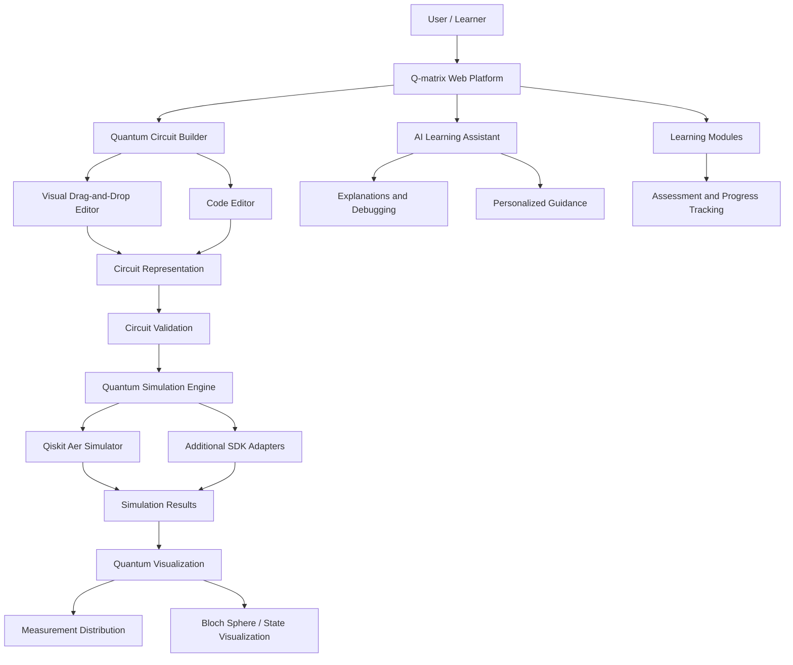

# ⚛️ Q-matrix

**VTU-QFF-HC-0024** | Tier: **Both**

---

| | |
|---|---|
| **Team** | Q-matrix |
| **Team ID** | VTU-QFF-HC-0024 |
| **Tier** | Both |
| **Repository** | [vtu-hc-q-matrix](https://github.com/vtu-qiskit-fall-fest-2026/vtu-hc-q-matrix.git) |
| **Organisation** | [vtu-qiskit-fall-fest-2026](https://github.com/vtu-qiskit-fall-fest-2026) |
| **Event** | VTU-QFF Hackathon — VTU-Qiskit Fall Fest 2026 |

---

## 📌 Table of Contents

- [Team Members](#-team-members-github-ids)
- [Problem Statement](#-problem-statement)
- [Proposed Solution](#-proposed-solution)
- [Approach & Architecture](#-approach--architecture)
- [Tech Stack](#-tech-stack)
- [Project Structure](#-project-structure)
- [How to Run](#-how-to-run)
- [How to Push Code](#-how-to-push-code)
- [Submission Checklist](#-submission-checklist)
- [Resources](#-resources)
- [License](#-license)

---

## 👥 Team Members (GitHub IDs)

| # | Name | GitHub Username | Role |
|---|---|---|---|
| 1 | Chinmay R | ChinmayRERC | Team Lead |
| 2 | M Naveen | Naveenmuchetty-67 | Developer 1 |
| 3 | Thulasi Ram M | Ram0528 | Developer 2 |

---

## ❓ Problem Statement

### AI-Based Interactive Quantum Algorithm Learning Platform

**Background:**

Quantum computing is a transformative technology with significant impact across scientific and industrial domains. However, education in this field remains challenging due to the abstract nature of core concepts such as qubits, superposition, entanglement, and quantum algorithms.

Existing learning resources are often static, heavily theoretical, and lack hands-on interaction.

Limited access to real quantum hardware further restricts practical learning. There is a strong need for an integrated, interactive, and intelligent platform that combines theoretical instruction, visual circuit design, real-time simulation, and personalized AI-based guidance to accelerate quantum education and workforce development.

**Description:**

The goal is to develop an AI-powered interactive web-based platform that enables students, researchers, and professionals to learn, design, simulate, and visualize quantum algorithms.

The platform will offer structured learning modules covering quantum computing fundamentals, circuit design, and standard quantum algorithms.

Users will be able to construct quantum circuits through a drag-and-drop interface or by writing code, execute them on multiple quantum simulators, and visualize quantum states and measurement outcomes.

AI-assisted features will provide real-time explanations, error detection, optimization suggestions, and personalized learning paths.

The system will support major quantum software development kits and promote collaborative and modular learning.

**Why it matters:**

Quantum computing education requires more than theoretical explanations. Students need an accessible environment where they can experiment with quantum circuits, observe quantum behavior, understand complex algorithms, and learn from their mistakes.

Q-matrix aims to bridge the gap between theoretical quantum computing knowledge and practical implementation through interactive simulation, visualization, and intelligent educational assistance.

**Track / Category:** Quantum Computing | AI-Powered Education | Interactive Web Application

---

## 💡 Proposed Solution

### Objectives

- Design and develop an interactive web-based platform for learning quantum computing and quantum algorithms.
- Provide graphical drag-and-drop and code-based quantum circuit design tools.
- Enable quantum circuit execution using simulator backends, initially Qiskit Aer, with modular support planned for PennyLane and Cirq.
- Integrate AI-assisted tutoring for concept explanation, code assistance, debugging, and personalized learning recommendations.
- Support visualization of quantum states, Bloch spheres, measurement probabilities, and circuit execution results.
- Provide structured learning modules covering qubits, quantum gates, superposition, entanglement, and quantum algorithms.
- Include assessment modules, coding challenges, progress tracking, and instructor dashboards.
- Promote collaborative and modular quantum learning.

### Expected Solution

A comprehensive AI-based interactive quantum learning platform that integrates education, programming, simulation, visualization, and intelligent tutoring.

The platform will offer structured theoretical content, visual circuit builders, integrated code editors, modular quantum simulation support, AI-powered assistance, assessment tools, and progress analytics.

The solution will be designed to be accessible and extensible, contributing to the development of a quantum-ready workforce.

### Solution

**Q-matrix** is a proposed AI-powered interactive quantum learning platform that allows users to learn quantum concepts, construct circuits visually or through code, execute simulations, and analyze quantum behavior through interactive visualizations.

An integrated AI tutor will assist with conceptual explanations, circuit debugging, optimization suggestions, and personalized learning recommendations.

### Key Idea

**Learn → Build → Simulate → Visualize → Understand → Improve**

Q-matrix combines a visual quantum circuit editor, a quantum simulation engine, interactive visualization, and an AI-assisted tutoring system within one web-based learning environment.

### Why This Works

Traditional quantum learning resources often separate theoretical content from practical execution.

Q-matrix brings both together by enabling learners to experiment with quantum circuits while receiving contextual explanations and feedback.

The approach emphasizes practical experimentation, visual understanding, and personalized learning rather than passive theoretical instruction alone.

---

## 🧩 Approach & Architecture

### System Architecture



### Workflow

**1. Input — User Interaction**

Users interact with Q-matrix through a web interface. They can select learning modules, create circuits using drag-and-drop components, or write quantum programs in an integrated code editor.

**2. Circuit Construction and Validation**

The platform converts supported visual circuit operations into an internal circuit representation and then into simulator-compatible quantum circuits.

Validation checks may include:

- Invalid gate placement
- Missing or incorrect qubit references
- Unsupported operations
- Incompatible simulator options
- Incorrect circuit structure

**3. Quantum Core — Circuit Execution**

Validated circuits are executed using a quantum simulation backend.

The initial implementation will prioritize Qiskit Aer for local simulation. Other SDKs can be supported through separate adapters as the project develops.

Example algorithms include:

- Bell State Preparation
- Quantum Teleportation
- Deutsch–Jozsa Algorithm
- Grover's Search Algorithm
- Quantum Fourier Transform

**4. Post-processing — Quantum State Analysis**

Simulation results are transformed into user-friendly representations.

Depending on the circuit and simulator method, the platform may provide:

- Measurement counts
- Probability distributions
- Statevector information
- Single-qubit Bloch sphere visualizations
- Circuit execution summaries
- Ideal versus sampled measurement comparisons

**5. AI-Based Intelligent Assistance**

The AI tutor receives relevant circuit details, simulation results, and the learner's question.

It provides contextual guidance to help students understand their quantum programs.

Proposed capabilities:

- Explain quantum gates and algorithms
- Interpret simulation outcomes
- Identify possible circuit errors
- Recommend debugging steps
- Suggest possible optimizations
- Generate educational hints
- Recommend subsequent learning topics

Circuit correctness will be determined by deterministic validation and simulator results rather than relying solely on AI-generated explanations.

**6. Output — Interactive Learning Experience**

Users receive circuit diagrams, simulation results, visualizations, AI explanations, and actionable educational feedback.

The platform also aims to record learning progress and recommend suitable exercises based on performance.

---

## 🛠️ Tech Stack

*Proposed implementation stack — to be finalized during development.*

| Layer | Technology |
|---|---|
| Frontend | React / Next.js |
| Programming Languages | Python 3.11+, TypeScript |
| UI Design | Tailwind CSS |
| Circuit Builder | React Flow / Custom Quantum Gate Editor |
| Code Editor | Monaco Editor |
| Backend API | FastAPI |
| Primary Quantum SDK | Qiskit |
| Quantum Simulation | Qiskit Aer |
| Additional Quantum SDKs | PennyLane, Cirq (planned adapters) |
| Quantum Visualization | Plotly, Qiskit Visualization |
| AI Assistance | LLM API or Local LLM with structured circuit context |
| Database | PostgreSQL / SQLite |
| Authentication | To be selected |
| Testing | Pytest, frontend testing framework |
| Development Environment | VS Code / JupyterLab |
| Version Control | Git + GitHub |

---

## 📁 Project Structure

*Suggested repository structure.*

```text
vtu-hc-q-matrix/
├── README.md
├── requirements.txt
├── pyproject.toml
├── .gitignore
│
├── frontend/
│   ├── src/
│   │   ├── components/
│   │   │   ├── CircuitBuilder/
│   │   │   ├── CodeEditor/
│   │   │   ├── Visualization/
│   │   │   └── AITutor/
│   │   ├── pages/
│   │   ├── services/
│   │   └── utils/
│   └── package.json
│
├── backend/
│   ├── main.py
│   ├── api/
│   ├── models/
│   ├── services/
│   │   ├── circuit_engine.py
│   │   ├── simulator.py
│   │   ├── visualization.py
│   │   └── ai_tutor.py
│   └── quantum/
│       ├── qiskit_adapter.py
│       ├── cirq_adapter.py
│       └── pennylane_adapter.py
│
├── learning/
│   ├── fundamentals/
│   ├── quantum_gates/
│   ├── algorithms/
│   └── assessments/
│
├── notebooks/
│   └── quantum_experiments.ipynb
│
├── tests/
│   ├── test_circuits.py
│   ├── test_simulator.py
│   └── test_api.py
│
├── docs/
│   ├── architecture.md
│   └── implementation.md
│
└── assets/
    └── screenshots/
```

---

## 🚀 How to Run

*These are proposed setup instructions. The repository must contain the corresponding application files and dependencies before these commands will work.*

### Prerequisites

- Python 3.11 or newer
- Node.js and npm
- Git
- A GitHub account with repository access

### 1. Clone the Repository

```bash
git clone https://github.com/vtu-qiskit-fall-fest-2026/vtu-hc-q-matrix.git
cd vtu-hc-q-matrix
```

### 2. Create a Python Virtual Environment

```bash
python3 -m venv .venv
source .venv/bin/activate
```

Windows (PowerShell):

```powershell
.venv\Scripts\Activate.ps1
```

### 3. Install Backend Dependencies

```bash
pip install --upgrade pip
pip install -r requirements.txt
```

### 4. Start Backend Server

```bash
uvicorn backend.main:app --reload
```

### 5. Start Frontend

Open another terminal:

```bash
cd frontend
npm install
npm run dev
```

### 6. Run Tests

```bash
pytest -q
```

### 7. Launch the Application

Open the local development URL displayed by the frontend development server.

---

## 🔁 How to Push Code

### Configure Git (First Time Only)

```bash
git config --global user.name "Your Name"
git config --global user.email "you@example.com"
```

### Everyday Workflow

```bash
# 1. Get the latest changes
git checkout main
git pull origin main

# 2. Create a branch
git checkout -b feature/my-task

# 3. Stage and commit
git add .
git commit -m "feat: add quantum circuit builder"

# 4. Push changes
git push -u origin feature/my-task

# 5. Open a Pull Request on GitHub

# 6. After approval and merge
git checkout main
git pull origin main
git branch -d feature/my-task
```

### Commit Message Convention

| Prefix | Meaning |
|---|---|
| `feat:` | New feature |
| `fix:` | Bug fix |
| `docs:` | Documentation changes |
| `test:` | Adding or fixing tests |
| `refactor:` | Code restructuring |
| `chore:` | Maintenance and configuration |

### Useful Commands

```bash
git status
git log --oneline -10
git diff
git stash
git pull --rebase
```

### Collaboration Guidelines

- Never push directly to `main`.
- Work on individual feature branches.
- Pull recent changes before starting new work.
- Submit Pull Requests for review.
- Resolve merge conflicts before merging.
- Commit frequently with descriptive messages.
- Ensure implemented features are tested before submission.

---

## ✅ Submission Checklist

- [ ] Repository created and public
- [ ] All team members added as collaborators
- [ ] README.md updated with project information
- [ ] Problem statement and proposed solution documented
- [ ] Interactive quantum circuit builder implemented
- [ ] Qiskit Aer simulation integrated
- [ ] Circuit validation implemented
- [ ] Quantum visualization implemented
- [ ] AI tutoring functionality implemented
- [ ] Structured learning modules added
- [ ] Basic assessment functionality implemented
- [ ] Backend and frontend integrated
- [ ] Dependencies documented
- [ ] Automated tests passing
- [ ] Project runs from a clean clone
- [ ] Latest code committed to `main`
- [ ] Demo screenshots or video included
- [ ] Short project summary submitted on the hackathon portal

---

## 📚 Resources

| Resource | Link |
|---|---|
| Git & Collaboration Handbook | [Git & Collaboration Handbook](../vtu-hc-guide-git-and-collaboration) |
| Problem Statements & Solutions | [Problem Statements, Solutions & Terms](../vtu-hc-guide-problem-and-solution) |
| README Guide | [README Guide & Template](../vtu-hc-guide-readme-template) |
| Qiskit Documentation | https://quantum.cloud.ibm.com/docs/ |
| Qiskit Aer | https://qiskit.github.io/qiskit-aer/ |
| IBM Quantum Platform | https://quantum.cloud.ibm.com/ |
| IBM Quantum Learning | https://quantum.cloud.ibm.com/learning |
| PennyLane | https://pennylane.ai/ |
| Google Cirq | https://quantumai.google/cirq |
| GitHub Documentation | https://docs.github.com/ |

---

## 📄 License

Released under the MIT License, subject to inclusion of the corresponding `LICENSE` file in the repository.

---

**Q-matrix** · Team ID `VTU-QFF-HC-0024` · Tier `Both`

Built with ⚛️ Qiskit for the VTU-QFF Hackathon

[⬆ Back to Top](#-q-matrix)
